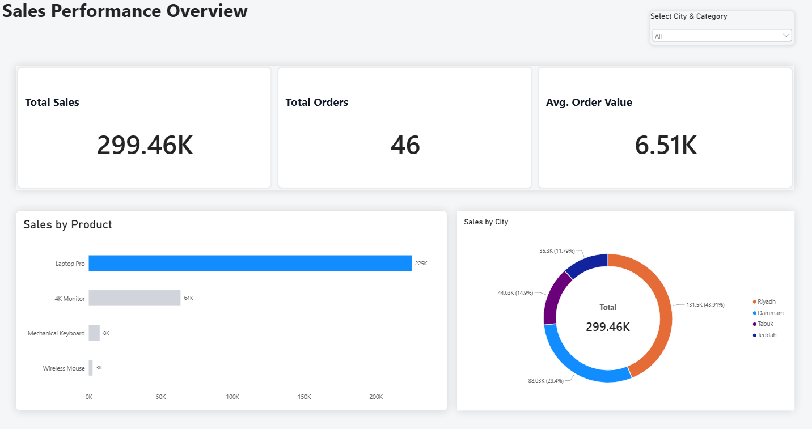

# 🚀 End-to-End Sales ETL Pipeline & BI Dashboard

[English Version](#-english-version) | [النسخة العربية](#-النسخة-العربية)

---

<a name="-english-version"></a>
## 🇬🇧 English Version

### 📌 Project Overview
This project demonstrates an end-to-end data engineering and business intelligence workflow. It features an automated, idempotent **Extract, Transform, and Load (ETL)** pipeline built with **Python** and **Microsoft SQL Server 2022**, culminating in an interactive executive dashboard built with **Power BI**. The pipeline simulates real-world data operations by generating messy Excel datasets, cleansing and validating records via **Pandas**, loading them into a normalized relational database (`Sales_ETL_DB`), creating analytical SQL views, and visualizing key sales KPIs.

### 📊 Executive Dashboard Preview


### 💡 Key Business Insights
* **Total Revenue:** **299.46K** across **46** valid orders, yielding an Average Order Value (AOV) of **6.51K**.
* **Top-Performing Product:** **Laptop Pro** dominates revenue generation at **225K** (~75% of total sales), followed by **4K Monitor** at **64K**.
* **Regional Performance:** **Riyadh** leads all regions with **131.5K (43.91%)** of total sales, followed by **Dammam** with **88.03K (29.4%)**.

### 🛠️ Tech Stack & Tools
* **Programming & ETL:** Python 3.x (`Pandas`, `OpenPyXL`, `Faker`)
* **Database Engine:** Microsoft SQL Server 2022 (SSMS, T-SQL Views)
* **Database Connectivity:** `SQLAlchemy`, `pyodbc` (ODBC Driver 17 for SQL Server)
* **Data Visualization & BI:** Microsoft Power BI Desktop
* **Version Control:** Git & GitHub

### 📂 Repository Structure
```text
├── data/
│   └── raw_sales_data.xlsx             # Synthetic multi-sheet raw Excel dataset
├── create_sales_tables.sql             # DDL script for database, schemas, and relational tables
├── create_view_sales.sql               # Analytical SQL View joining sales tables for Power BI
├── generate_sales_data.py              # Generates synthetic data with intentional anomalies
├── sales_etl_pipeline.py               # Main idempotent ETL pipeline (Extract, Clean, Load)
├── Sales_Performance_Dashboard.pbix    # Interactive Power BI report file
├── Sales_Performance_dashboard.png     # High-resolution preview of the final dashboard
└── README.md                           # Bilingual project documentation
```

### ⚙️ Pipeline Architecture & Workflow
1. **Database Architecture (`create_sales_tables.sql`):**
   * Designed a dedicated relational database (`Sales_ETL_DB`) with separated schemas (`staging` and `sales`) to enforce enterprise data organization standards.
   * Built normalized tables (`sales.Customers`, `sales.Products`, `sales.Orders`) protected by Primary Key and Foreign Key constraints.
2. **Synthetic Data Generation (`generate_sales_data.py`):**
   * Generated realistic customer, product, and order records into a multi-sheet Excel file (`raw_sales_data.xlsx`) using `Faker`, intentionally injecting duplicate IDs and `NULL` values.
3. **ETL Execution (`sales_etl_pipeline.py`):**
   * **Extract:** Programmatically ingested multiple worksheets from `raw_sales_data.xlsx` into Pandas DataFrames.
   * **Transform:** Deduplicated primary keys, dropped records missing critical attributes, imputed missing quantities, standardized date formats, and filtered orphaned records to preserve referential integrity.
   * **Idempotent Load:** Executed a safe reverse-order cleanup (`DELETE`) prior to loading parent tables (`Customers`, `Products`) followed by the child table (`Orders`), allowing safe re-execution.
4. **Analytical Layer & Visualization (`create_view_sales.sql` & Power BI):**
   * Created a consolidated SQL View (`create_view_sales.sql`) to serve clean, joined data directly to Power BI.
   * Designed an executive dashboard featuring dynamic hierarchical slicers (City & Category), KPI cards, selective color-highlighted bar charts, and regional donut charts.

### 🚀 How to Run
1. **Database Setup:** Execute `create_sales_tables.sql` and `create_view_sales.sql` in **SSMS**.
2. **Install Python Libraries:**
   ```bash
   pip install pandas openpyxl sqlalchemy pyodbc faker
   ```
3. **Generate & Load Data:**
   ```bash
   python generate_sales_data.py
   python sales_etl_pipeline.py
   ```
4. **Explore Dashboard:** Open `Sales_Performance_Dashboard.pbix` in **Power BI Desktop** to interact with the visuals and filters.

---

<a name="-النسخة-العربية"></a>
## 🇸🇦 النسخة العربية
# 🚀 مشروع متكامل: هندسة بيانات المبيعات ولوحة ذكاء الأعمال

### 📌 نظرة عامة على المشروع
يقدم هذا المشروع دورة حياة البيانات الكاملة بدءاً من هندسة البيانات وحتى ذكاء الأعمال. يتضمن المشروع بناء خط أنابيب بيانات مؤتمت وقابل لإعادة التشغيل (**Idempotent ETL Pipeline**) باستخدام **Python** و **Microsoft SQL Server 2022**، وصولاً إلى تصميم لوحة تحكم تنفيذية تفاعلية باستخدام **Power BI**. يحاكي المشروع بيئة العمل الواقعية عبر توليد بيانات خام تحتوي على أخطاء مقصودة، وتنظيفها والتحقق من جودتها باستخدام **Pandas**، وضخها في قاعدة بيانات علائقية منظمة (`Sales_ETL_DB`)، ثم بناء عروض تحليلية (**Views**) لربطها بلوحة المؤشرات.

### 💡 أبرز النتائج ومؤشرات الأداء المستخرجة
* **إجمالي المبيعات (Total Sales):** بلغ **299.46K** من خلال **46** طلباً مكتملاً، بمتوسط قيمة طلب (**Avg. Order Value**) يصل إلى **6.51K**.
* **المنتج الأكثر مبيعاً:** يتصدر منتج **Laptop Pro** المبيعات بقيمة **225K** (ما يقارب 75% من الإجمالي)، يليه **4K Monitor** بقيمة **64K**.
* **الأداء الجغرافي للمدن:** تستحوذ مدينة **الرياض** على الحصة الأكبر من المبيعات بقيمة **131.5K (43.91%)**، تليها **الدمام** بقيمة **88.03K (29.4%)**.

### 🛠️ التقنيات والأدوات المستخدمة
* **البرمجة ومعالجة البيانات:** Python 3.x (`Pandas`، `OpenPyXL`، `Faker`)
* **قواعد البيانات:** Microsoft SQL Server 2022 (SSMS، T-SQL Views)
* **الربط بقواعد البيانات:** `SQLAlchemy`، `pyodbc` (ODBC Driver 17 for SQL Server)
* **تصور البيانات وذكاء الأعمال:** Microsoft Power BI Desktop
* **إدارة الإصدارات:** Git و GitHub

### ⚙️ مراحل عمل المشروع (Workflow)
1. **هيكلة قاعدة البيانات (`create_sales_tables.sql`):**
   * إنشاء قاعدة بيانات مستقلة (`Sales_ETL_DB`) مقسمة إلى مخططات منظمة (`staging` و `sales`).
   * بناء الجداول العلائقية (`sales.Customers`، `sales.Products`، `sales.Orders`) مع تفعيل قيود المفاتيح الأساسية والأجنبية (`Primary & Foreign Keys`).
2. **توليد البيانات الخام (`generate_sales_data.py`):**
   * توليد بيانات عملاء ومنتجات وطلبات وحفظها في ملف إكسل (`raw_sales_data.xlsx`) باستخدام مكتبة `Faker` مع حقن أخطاء مقصودة (تكرار وقيم فارغة `NULL`).
3. **المعالجة والتحميل الآمن (`sales_etl_pipeline.py`):**
   * **الاستخراج (Extract):** قراءة أوراق العمل من الإكسل وتحويلها إلى جداول `Pandas DataFrames`.
   * **التنظيف والتحويل (Transform):** إزالة التكرار، استبعاد السجلات الناقصة، تعويض القيم الفارغة، توحيد التواريخ، وحذف السجلات اليتيمة لحماية الروابط المرجعية.
   * **التحميل الآمن (Idempotent Load):** تفريغ الجداول بالترتيب العكسي قبل الضخ لضمان إمكانية إعادة تشغيل السكربت بأمان دون أخطاء تكرار.
4. **الطبقة التحليلية ولوحة التحكم (`create_view_sales.sql` & Power BI):**
   * إنشاء عرض تحليلي (`SQL View`) يجمع بيانات الجداول لتسهيل قراءتها في Power BI.
   * بناء لوحة تحكم تفاعلية تضم فلاتر هرمية (المدينة والفئة)، وبطاقات مؤشرات الأداء الرئيسية، ومخططات تحليل المنتجات والمدن.
